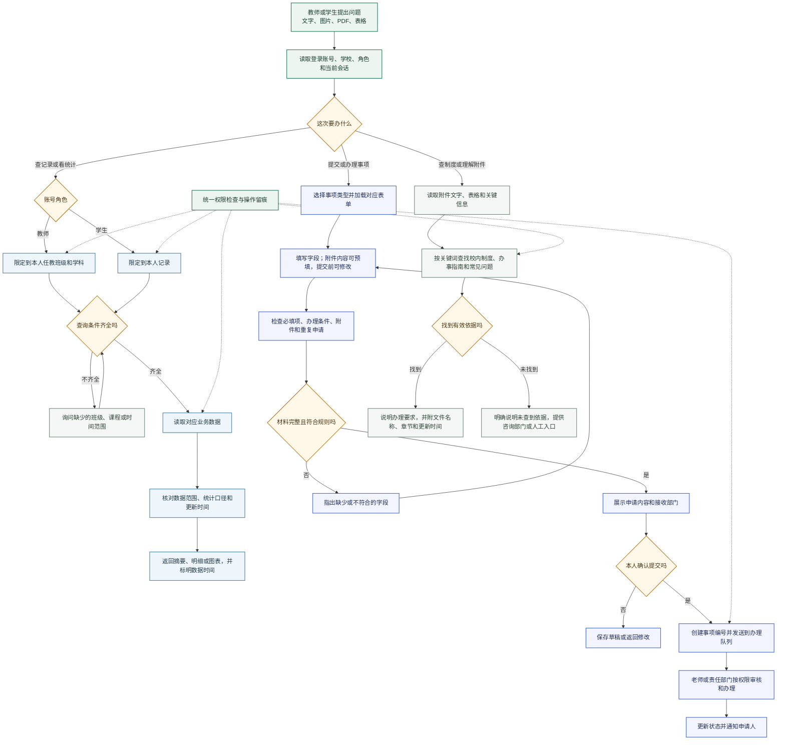
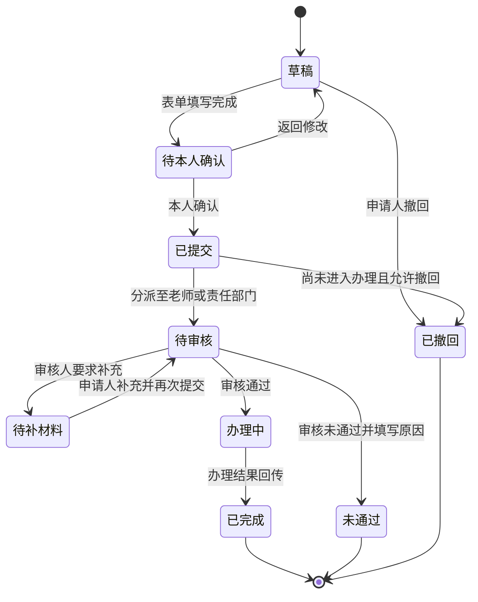

# 校园服务台业务流程

这份流程按师生实际办事路径组织：先确认账号和可见范围，再查询数据、提交事项或查找校内制度。重点是把每一步由谁操作、读取什么、何时需要本人确认、结果到哪里查看说清楚。

## 总体流程

## 按角色提供的功能

| 教师端 | 主要操作 | 学生端 | 主要操作 |
| --- | --- | --- | --- |
| 班级与课程 | 查看本人任教班级、课程安排、出勤和作业进度 | 个人记录 | 查看本人课表、出勤、成绩及已提交事项 |
| 班级统计 | 按班级、课程和时间查看趋势、分布及未完成事项 | 业务申请 | 发起报修、报销、场地预约等校内事项 |
| 待办办理 | 查看分配给本人的审核任务，补充意见并更新结果 | 申请跟进 | 查看事项编号、当前状态、审核意见和待补材料 |
| 校园资料 | 查找校内制度、办事指南和相关通知 | 附件与材料 | 上传或查看图片、票据、PDF 等申请材料 |
| 报表导出 | 导出本人权限范围内的统计明细 | 校园咨询 | 查找制度要求、办理入口和负责部门 |

所有查询按账号权限过滤。教师不能因为提出问题就读取未负责班级的个人明细；学生端只显示本人记录。班级统计只返回完成该任务所需的汇总信息。

## 事项办理状态

事项详情至少显示编号、提交时间、当前处理部门、状态、最近更新时间和下一步操作。需要补充材料时说明具体字段；未通过时保留审核原因。允许撤回的范围由事项规则决定。

## 查询、附件与失败处理

- **查询结果**：显示数据统计范围、数据更新时间和可追溯的记录来源；图表可继续筛选或导出。只读查询不会改动业务记录。
- **附件读取**：将预填字段展示给用户校对。姓名、金额、日期、地点等关键信息不确定时标出待确认项，不直接作为已确认内容提交。
- **重复提交**：提交前检查同一账号、同类事项和相近时间的未结记录；发现疑似重复时先提示用户查看原申请。
- **权限不足**：说明当前账号能查看的范围，并指向有权限的老师或部门；不在回答中带出越权数据。
- **数据源不可用**：说明哪个查询暂时失败，保留用户已填写内容；提供重试入口。不能用猜测值代替查询结果。
- **依据缺失或过期**：回答中说明未找到有效制度，不把旧通知当成当前规定；给出负责部门和人工咨询方式。
- **审核与追踪**：提交、补件、审核和状态变化都记录操作人和时间，页面与通知使用同一事项状态。

## 页面提示用语

页面只展示正在执行的具体步骤，不使用没有业务含义的“思考中”或虚构进度百分比。例如：

- `正在读取本人课表`
- `正在核对申请材料中的日期和金额`
- `申请已提交，事项编号：BX-20261031-018`
- `暂时无法读取报修记录，已保留填写内容，可重试`

长时间任务只有在服务端返回真实阶段或进度时才显示进度条；否则显示当前步骤和重试/离开后查看状态的入口。
