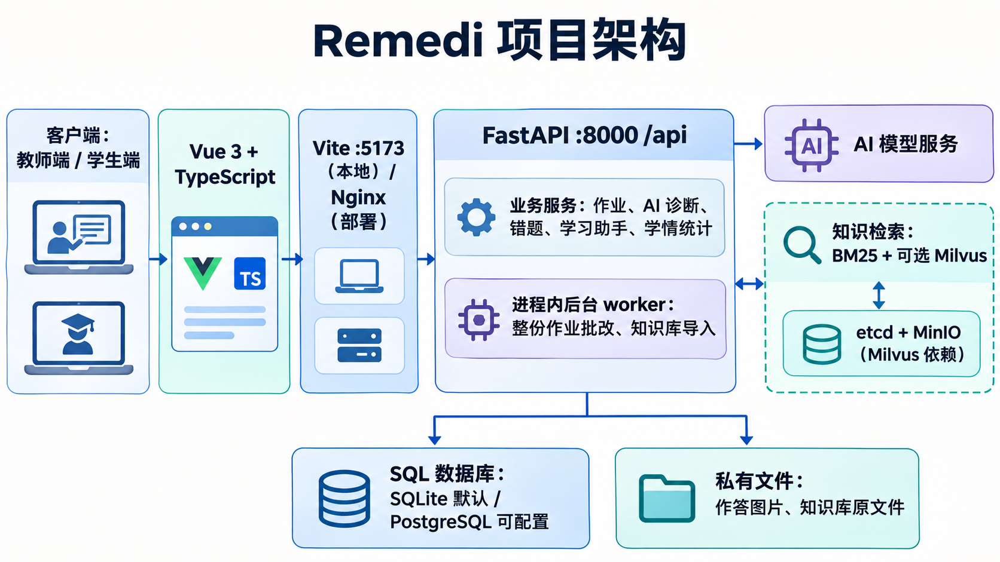
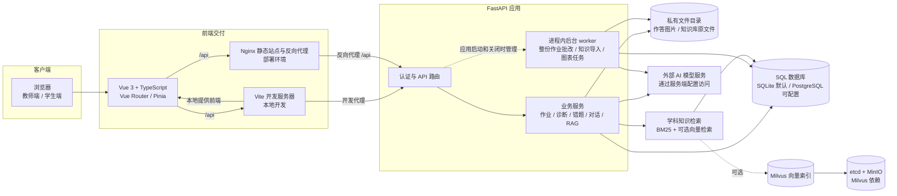

# 系统架构

## 总览

教师端和学生端由同一个 Vue 单页前端提供，根据登录身份展示相应功能。前端经 `/api` 调用 FastAPI；作业、批改任务、错题和学习数据以 SQL 数据库为主记录。上传的作答图片、知识库原文件等放在配置的文件目录中。后台批改与知识导入由 FastAPI 应用启动的进程内 worker 执行。

## 组件职责

| 组件 | 职责 | 代码或配置入口 |
| --- | --- | --- |
| Vue 前端 | 教师和学生工作台、作答交互、结果与进度展示 | `frontend/src/` |
| FastAPI | 登录鉴权、角色权限、作业/错题/知识库/对话 API | `backend/app/main.py`、`backend/app/routers/` |
| 业务服务 | 批改诊断、计分、错题沉淀、学情统计、知识检索 | `backend/app/services/`、`backend/app/agent/` |
| 后台 worker | 在服务端执行整份作业批改、知识库导入和图表任务 | `backend/app/lifespan.py`、`backend/app/services/` |
| SQL 数据库 | 用户、作业、题目、作答、批改任务、诊断、订正和学习记忆 | `backend/app/models.py`、`backend/app/database.py` |
| 文件目录 | 保存作答图片与导入资料等文件；路径由服务端配置管理 | `backend/app/config.py` |
| Milvus | 可选的学科向量检索索引 | `backend/app/services/rag_milvus.py`、`docker-compose.milvus.yml` |
| AI 模型服务 | 题目识别、作答诊断、教学对话等模型调用 | `backend/app/services/providers.py`、`backend/app/config.py` |

## 开发和部署路径

- 本地开发通常由 Vite 在 `5173` 提供前端，并把 `/api` 代理到 FastAPI `8000`。前端 API 地址支持环境配置。
- 仓库的线上部署约定由项目 `AGENTS.md` 维护：宝塔 Nginx 提供前端静态文件并代理 API，后端由 Python 应用运行；Milvus、etcd、MinIO 使用 Compose 管理。端口和实例以当前服务器配置为准。
- `deploy/nginx.conf` 展示的是容器化 Nginx 示例，不等同于上述服务器的完整生产拓扑。

## 后台任务与可靠性边界

整份作业批改和知识导入任务会先写入 SQL，再由 FastAPI 生命周期启动的 worker 执行。因此学生关闭页面或退出登录，不会取消已经提交的服务端任务。应用重启后会从数据库恢复中断的任务；应用进程停止期间任务暂停，重新启动后才继续。数据库和私有文件目录需要持久化，才能恢复完整任务。

当前整份作业批改 worker 直接运行在 FastAPI 进程内，数据库中的任务记录承担持久队列状态；项目没有用 Redis/Celery 作为这条批改链路的任务队列。异常任务会自动重新排队，重试等待时间逐步增加并封顶 300 秒；目前代码没有设置总重试次数上限。它不代表服务停机期间仍有进程在运行。
