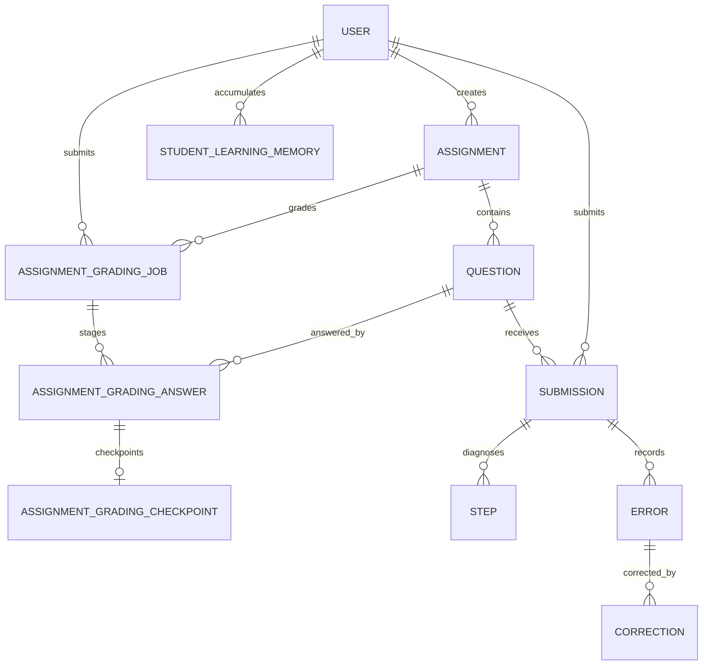
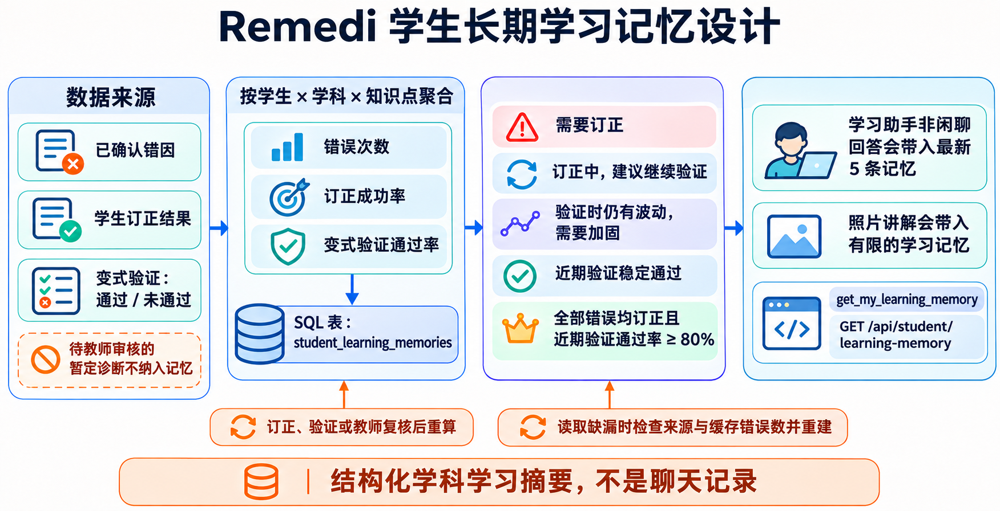
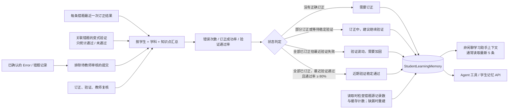

# 数据与接口索引

## 作业与批改数据

图中只列出主流程相关实体，完整字段和约束见 [数据库设计](../schema-design.md)。主要模型如下：

| 数据 | 作用 |
| --- | --- |
| `Assignment`、`Question` | 教师发布的作业及其题目 |
| `AssignmentGradingJob` | 学生整份作业批改任务、状态、进度、重试次数和下次执行时间 |
| `AssignmentGradingAnswer` | 每道题暂存的文字或图片答案 |
| `AssignmentGradingCheckpoint` | 成功处理的单题诊断结果；输入变化后按指纹重新计算 |
| `Submission`、`Step`、`Error` | 正式提交、分步诊断与错因记录 |
| `Correction`、`Verification` | 学生订正与后续变式验证 |
| `StudentLearningMemory` | 从错题、订正和验证状态汇总出的学科知识点记忆 |
| `KnowledgeImportJob`、知识片段模型 | 教师资料导入任务与可检索知识内容 |

## API 分组

API 路由在 `backend/app/main.py` 注册。主要入口：

| 用途 | 路由前缀或接口 |
| --- | --- |
| 登录与鉴权 | `backend/app/routers/auth.py` |
| 教师发布作业、查看班级 | `/api/teacher/assignments`、`/api/teacher/classes` |
| 教师查看单份作业题目与学情 | `/api/teacher/assignments/{assignment_id}`、`/api/teacher/assignments/{assignment_id}/analytics` |
| 学生查看作业、作答、提交、查询状态 | `/api/student/assignments...` |
| 学生错题本、订正和验证 | `/api/student/mistakes...`、`/api/student/corrections...`、`/api/student/verifications...` |
| 教师上传知识库资料和查询导入进度 | `/api/teacher/knowledge...` |
| 教师班级数据与教学建议 | `/api/teacher/dashboard`、`/api/teacher/suggestions` 等 |

完整请求/响应字段见 [API 契约](../api-contract.md)。

## 对话与学习记忆的边界

- 普通学习助手对话使用 Agent 会话与消息记录，学生和教师有各自的会话 API。
- 错题本中的题目专属讲解使用 `StudentMistakeChatMessage`，接口位于 `/api/student/mistakes/{mistake_id}/chat`；它与普通主页 `chat_sessions` 分开存储，避免两个场景互相串话。
- `StudentLearningMemory` 是从本人错题、订正和验证结果汇总的结构化学科学习记忆，不是完整的聊天逐字记录。普通学习助手在非闲聊请求中会把相关记忆作为回答上下文；闲聊不读取学情数据。照片答疑也会带入有限的错题和学习记忆摘要。
- 待教师审核的诊断不会作为已确认的长期学习结论。学生长期记忆 API 为 `GET /api/student/learning-memory`；Agent 也提供 `get_my_learning_memory` 工具。

## 学生长期学习记忆设计

记忆键为“学生、学科、知识点”。订正指标取每条错题最近一次订正记录，只有 `is_correct` 有明确值时才计入订正率；变式验证统计已通过或未通过的结果。状态根据错题数、成功订正数、最近一次验证状态及验证通过率派生。普通助手只在非闲聊请求中注入有限条记忆，照片讲解也会读取有限摘要；这张表不保存历史对话全文。

## 存储约定

SQL 是用户、作业、任务、诊断、订正、会话和知识内容等业务记录的主存储。Milvus 保存可重建的向量检索索引；etcd 和 MinIO 是 Milvus 的依赖服务。作答图片、知识库原文件等保存在服务端私有文件目录，数据库记录其关联路径。备份和迁移时需要同时考虑 SQL 数据与对应文件目录。
