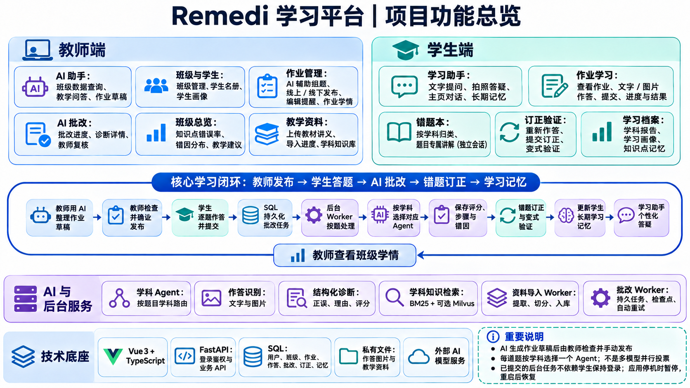
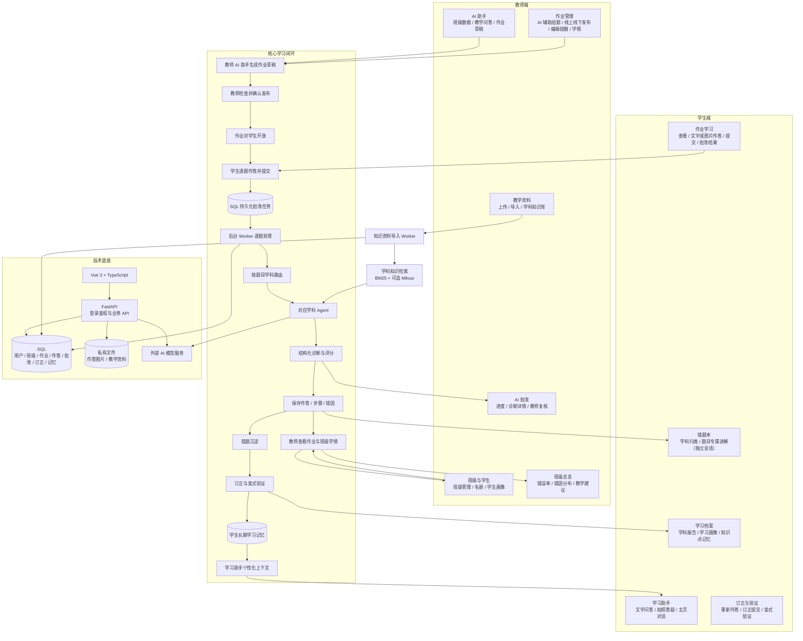

# 项目功能总览

总图按教师端、学生端、核心学习闭环、AI 与后台服务、技术底座归纳项目主要功能。教师先用 AI 整理作业草稿，再检查并手动发布；学生答题提交后，由持久化后台任务逐题分派对应学科 Agent 批改。错题经订正和变式验证后更新学生学习记忆，供学习助手个性化答疑和教师学情分析使用。

主页学习助手会话与错题本的题目专属讲解会话分别保存，互不串用。当前学科批改是逐题选择匹配的学科 Agent，不是多个模型并行投票。已经提交的后台任务不依赖学生保持登录；应用进程停止时任务暂停，应用重新启动后恢复处理。

