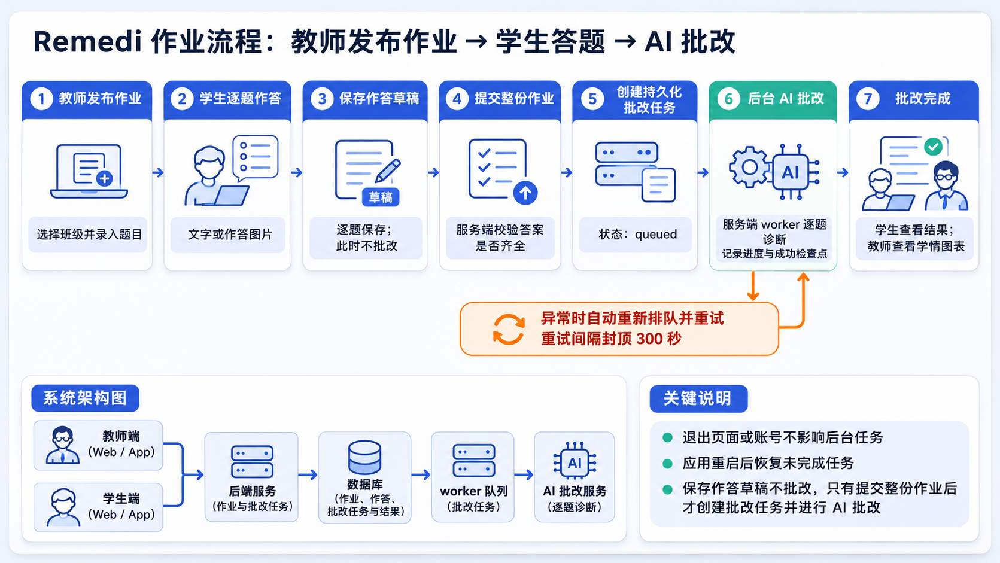
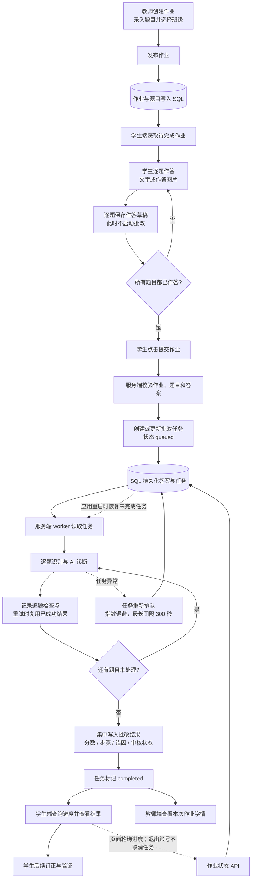
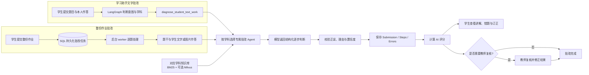
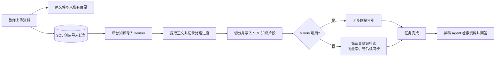

# 工作流简图

## 教师发布作业 → 学生答题 → 后台 AI 批改

### 作业批改状态

`draft → queued → processing → completed` 是常见路径。若后台处理遇到异常，任务自动回到队列并设置下一次尝试时间；已成功题目的检查点可在重试时复用。浏览器负责提交答案和查询状态，不负责维持批改任务。

## 多 Agent 学科批改

当前“多 Agent”指由路由按学科选择对应的专属批改 Agent，并提供该学科的知识库上下文；整份作业由后台 worker 按题逐个调度。一次作答由匹配的学科 Agent 处理，不是多个模型并行评分或投票。

常用接口：

- 教师发布：`POST /api/teacher/assignments`
- 学生查看作业：`GET /api/student/assignments`
- 学生逐题暂存：`PUT /api/student/assignments/{assignment_id}/answers/{question_id}`
- 学生提交整份作业：`POST /api/student/assignments/{assignment_id}/submit`
- 学生查看批改进度：`GET /api/student/assignments/{assignment_id}/grading-status`
- 教师查看作业学情：`GET /api/teacher/assignments/{assignment_id}/analytics`

### 截止时间与允许修改

整份作业提交接口会在答案齐全后把批改任务放入后台队列。代码中另有逐题提交、作文等提交路径：教师若开启“允许修改”并设置截止时间，截止前的提交可能按规则延迟诊断，到期扫描任务约每分钟执行一次。查看具体页面为何等待时，应先确认作业模式、截止时间和 `allow_revision` 设置；这项规则不等于普通整份作业任务需要用户保持在线。

## 教师导入学科资料

SQL 保存知识内容和任务进度，Milvus 只承担可选的向量索引。Milvus 同步不可用时可回退到 BM25 关键词检索；知识导入任务同样由服务端持久化并在启动时恢复。
