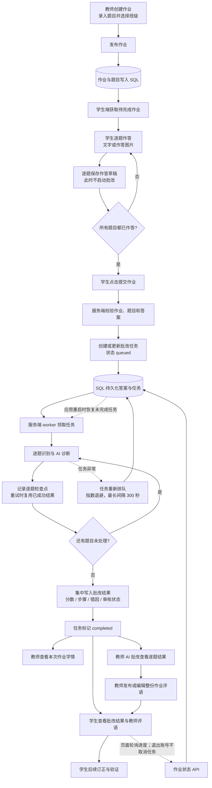
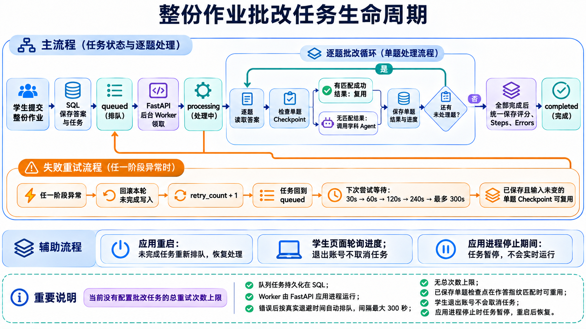
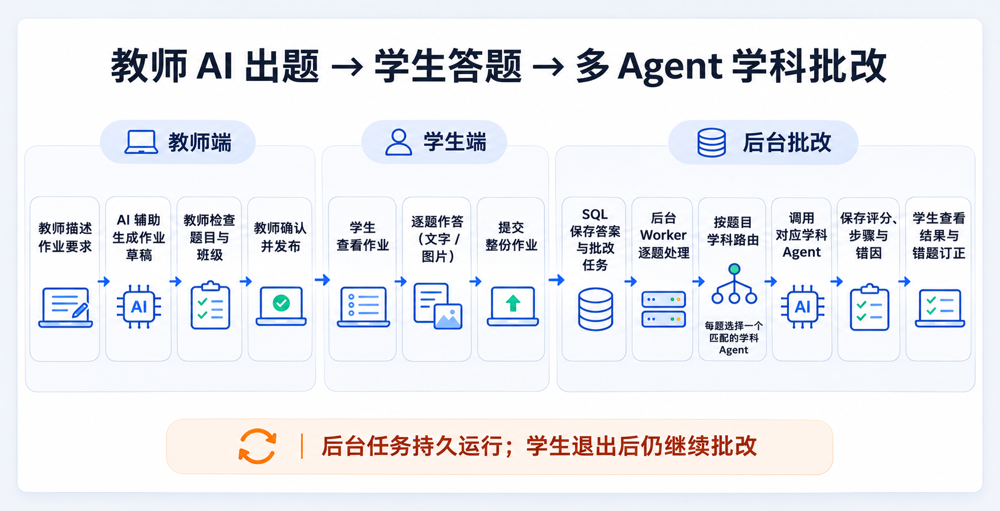
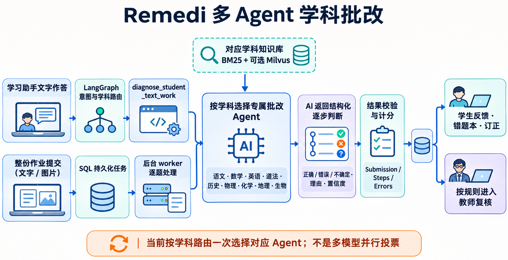
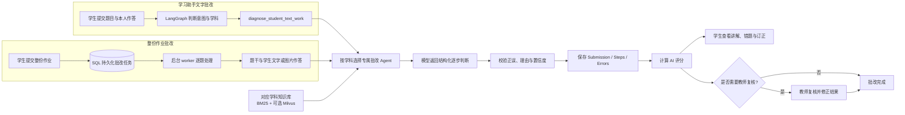
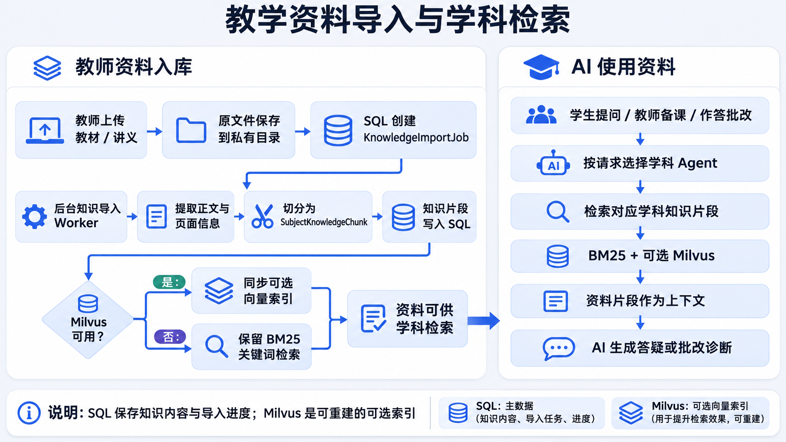
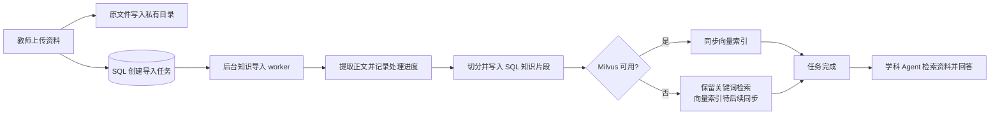

# 工作流简图

## 教师发布作业 → 学生答题 → 后台 AI 批改

### 作业批改状态

`draft → queued → processing → completed` 是常见路径。若后台处理遇到异常，任务自动回到队列并设置下一次尝试时间；已成功题目的检查点可在重试时复用。浏览器负责提交答案和查询状态，不负责维持批改任务。

批改任务保存在 SQL，由 FastAPI 进程内的 worker 领取。异常后任务重新排队，间隔依次增加并最多等待 300 秒；当前没有配置批改任务的总重试次数上限。应用进程停止时任务暂停，应用重新启动后恢复；学生退出账号不会取消已提交的任务。

## 教师 AI 发布作业 → 学生答题 → 多 Agent 学科批改

教师可先让 AI 助手根据要求整理题目草稿，再检查题目和班级并手动确认发布。学生逐题作答后提交整份作业；服务端将批改任务持久化，由后台 worker 按题目学科选择对应 Agent 处理。一次只为每道题选择一个匹配学科的 Agent，不是多个模型并行投票；学生离开页面或退出账号不会取消后台任务。

```mermaid
flowchart LR
    T[教师描述作业要求] --> Draft[AI 助手生成作业草稿]
    Draft --> Review[教师检查题目与班级]
    Review --> Publish[教师确认并发布]
    Publish --> SQLAssignment[(作业与题目写入 SQL)]
    SQLAssignment --> StudentView[学生查看作业]
    StudentView --> Answer[逐题作答\n文字或图片]
    Answer --> Submit[提交整份作业]
    Submit --> Job[(SQL 保存答案与批改任务)]
    Job --> Worker[后台 worker 逐题处理]
    Worker --> Route[按题目学科路由]
    Route --> Agent[调用对应学科 Agent]
    Knowledge[对应学科知识库] --> Agent
    Agent --> Result[生成判断、理由与评分]
    Result --> Save[保存评分、步骤与错因]
    Save --> StudentResult[学生查看结果与错题订正]
    Save --> TeacherResult[教师查看本次作业学情]
    TeacherResult --> TeacherComment[教师检查逐题结果并发布或编辑整份评语]
    TeacherComment --> StudentResult
```

批改完成后，教师在「AI 批改」中选择作业和学生，查看逐题结果后可发布或编辑一条整份作业评语。评语按作业和学生唯一保存；学生从作业列表查看批改结果时，会在作业标题下、逐题结果前看到已发布的评语。接口权限和字段见 [API 契约](../api-contract.md) 4.31.3。

## 多 Agent 学科批改

当前“多 Agent”指由路由按学科选择对应的专属批改 Agent，并提供该学科的知识库上下文；整份作业由后台 worker 按题逐个调度。一次作答由匹配的学科 Agent 处理，不是多个模型并行评分或投票。

常用接口：

- 教师发布：`POST /api/teacher/assignments`
- 学生查看作业：`GET /api/student/assignments`
- 学生逐题暂存：`PUT /api/student/assignments/{assignment_id}/answers/{question_id}`
- 学生提交整份作业：`POST /api/student/assignments/{assignment_id}/submit`
- 学生查看批改进度：`GET /api/student/assignments/{assignment_id}/grading-status`
- 教师查看作业学情：`GET /api/teacher/assignments/{assignment_id}/analytics`

### 截止时间与允许修改

整份作业提交接口会在答案齐全后把批改任务放入后台队列。代码中另有逐题提交、作文等提交路径：教师若开启“允许修改”并设置截止时间，截止前的提交可能按规则延迟诊断，到期扫描任务约每分钟执行一次。查看具体页面为何等待时，应先确认作业模式、截止时间和 `allow_revision` 设置；这项规则不等于普通整份作业任务需要用户保持在线。

## 教师导入学科资料

SQL 保存知识内容、片段和导入任务进度。Milvus 只保存可重建的可选向量索引；Milvus 不可用时可回退到 BM25 关键词检索。知识导入任务会在应用启动时恢复。
